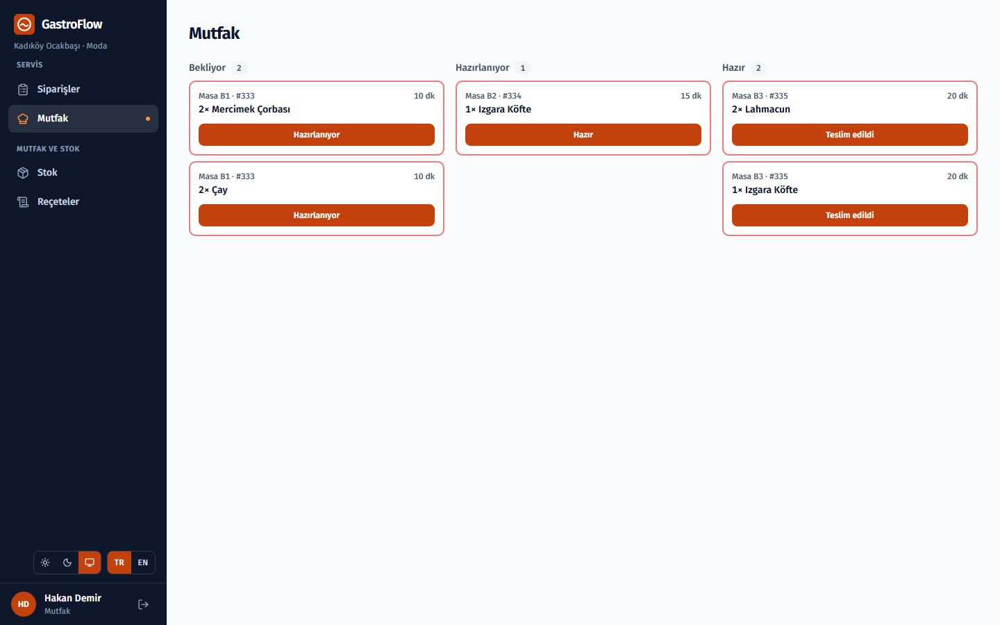
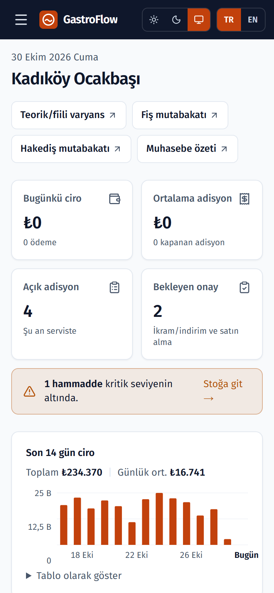

# GastroFlow

Çok kiracılı, rol bazlı bir restoran yönetim sistemi: sipariş alma, mutfak ekranı,
kasa, reçeteye dayalı stok düşümü, maliyet kontrolü, satın alma ve denetim kaydı.
Erişim kontrolü uygulamada değil, veritabanında (PostgreSQL Row Level Security) zorunlu.

## Hangi sorunu çözüyor

**Sorun.** Küçük ve orta ölçekli restoranlar sipariş, mutfak, kasa ve stok için ayrı araçlar ya da kâğıt kullanır. Satış stoktan düşmez, reçete maliyeti ve zayiat bilinmez; birden fazla şubede kimin hangi veriyi gördüğü kontrol edilemez.

**Çözüm.** Tek bir sistemde masadan siparişe, mutfak ekranından kasaya ve gün sonuna kadar akış. Her satış reçeteye göre stoktan düşer, teorik ve fiili tüketim karşılaştırılır. Patron canlı ciroyu ve bekleyen onayları telefondan görür.

**Durum.** Çekirdek akışlar çalışıyor ve demo olarak yayında. Yazarkasa, e-Arşiv ve paket platformu entegrasyonları adaptör arayüzüyle hazır ama ticari anlaşma gerektirdiği için şimdilik mock (ayrıntı aşağıda).

### Teknik kararlar

- **Kiracı izolasyonu veritabanında.** Her tabloda `force row level security`; uygulamadaki bir hata başka restoranın verisini açamaz. pgTAP testleriyle doğrulanır.
- **Sunucusuz demo.** Vercel'de veritabanı yerine süreç içinde PGlite çalışır; aynı migration'lar ve RLS politikalarıyla.
- **Bağlantı kopsa da sipariş kaybolmaz.** Mutasyonlar IndexedDB'de kuyruğa alınır ve idempotency anahtarıyla senkronlanır.
- **Denetim kaydını uygulama değil trigger yazar;** kayıtlar yalnızca eklenebilir.

## Ekran görüntüleri

<!-- docs/screenshots/ klasörüne bu adlarla PNG ekleyin. -->
| POS ve salon | Mutfak ekranı |
|---|---|
|  |  |
| **Stok ve maliyet** | **Patron paneli (telefon)** |
|  |  |

## Çalışma modları

| Mod | Ne zaman | Veritabanı |
|---|---|---|
| **Demo** | `DATABASE_URL` tanımlı değilken (Vercel) | Sunucu sürecinde çalışan [PGlite](https://pglite.dev); her açılışta migration'lar ve demo verisi yüklenir, birkaç saatte bir sıfırlanır |
| **Yerel** | `DATABASE_URL` tanımlıyken | Docker'daki PostgreSQL 17; veri kalıcıdır |

İki modda da aynı migration'lar, aynı RLS politikaları ve aynı tetikleyiciler çalışır; dış
bir servise (Supabase vb.) bağlantı yoktur. Demo girişinde her rol için tek tıkla giriş
düğmesi vardır; bütün demo hesaplarının şifresi `demo1234`.

## Özellikler

- **POS ve salon:** görsel masa düzeni, masa/Gel Al/Self Servis siparişi, modifier'lar, kombolar, ikram/iskonto onay akışı
- **QR menü:** müşteri masadaki QR koddan kendi telefonuyla sipariş verir; personel onaylayınca mutfağa gider
- **Mutfak ekranı (KDS):** birkaç saniyede bir yenilenen bilet akışı ve süre takibi
- **Kasa:** ödeme alma, hesap bölme, kupon ve sadakat puanı, kasa oturumu ve gün sonu
- **Stok:** satıştan reçeteye göre otomatik düşüm, zayiat, depolar arası transfer, körleme sayım, teorik/fiili varyans
- **Satın alma:** tedarikçiler, fiyat listeleri, onaylı satın alma siparişi, mal kabul
- **Raporlar:** ciro, fiş ve paket platformu hakediş mutabakatı, muhasebe özeti (Excel)
- **Patron mobil paneli (`/m`):** canlı ciro, bekleyen onaylar, olay akışı
- **Personel ve vardiya:** personel hesabı açma, rol yönetimi, haftalık vardiya çizelgesi
- **Offline dayanıklılık:** açık sipariş ve sayım ekranında bağlantı kesilince mutasyonlar kuyruğa alınır
- **PWA ve TR/EN arayüz**

## Henüz gerçek olmayan entegrasyonlar

Aşağıdakiler adaptör arayüzüyle hazır ama **mock** çalışıyor; gerçek bağlantı ticari anlaşma
veya sertifika gerektiriyor:

| Entegrasyon | Durum |
|---|---|
| ÖKC (yeni nesil yazarkasa) fişi | Mock (`src/lib/integrations/fiscal-device.ts`) |
| e-Arşiv fatura (GİB) | Mock (`src/lib/integrations/e-invoice.ts`) |
| Yemeksepeti / Getir / Trendyol Go | Mock (`src/lib/integrations/delivery-channel.ts`) |
| Bildirim e-postaları | Kuyruk ve kurallar gerçek, gönderim mock (`src/lib/notifications/process-queue.ts`) |

Fiş ve hakediş mutabakatı bu yüzden Excel ile içe aktarılan verilerle yapılır.

## Mimari

```
Next.js 16 (App Router)
  Server Component'ler   → sayfa verisini oturumdaki kullanıcının kimliğiyle okur
  Server Action'lar      → yazma işlemleri; tenant_id her zaman doğrulanmış oturumdan
  src/proxy.ts           → nonce'lu CSP, oturum tazeleme, rol bazlı yönlendirme

src/lib/db
  client.ts              → supabase-js istemcileri; istekleri ağa değil süreç içi handler'a gönderir
  rest.ts                → PostgREST sorgularını (select, iç içe ilişkiler, filtreler, upsert) SQL'e çevirir
  auth.ts                → şifreyle giriş, token yenileme, personel hesabı; HS256 JWT
  storage.ts             → menü görselleri storage.objects tablosunda
  engine.ts              → DATABASE_URL varsa node-postgres, yoksa PGlite

PostgreSQL
  RLS                    → her tabloda enable + force; politikalar JWT claim'lerinden okur
  custom_access_token_hook → JWT'ye tenant_id / branch_id / app_role yazar
  Trigger'lar            → durum geçişleri, append-only denetim kaydı, bildirim üretimi
  db/compat.sql          → migration'ların beklediği roller ve auth/storage şemaları
```

Sorgu katmanı olarak supabase-js kullanılıyor, ama arkasında Supabase yok: her istek
transaction içinde `anon`, `authenticated` ya da `service_role` rolüne geçip JWT
claim'lerini `request.jwt.claims` olarak ayarlar, böylece RLS politikaları Supabase'teki
gibi çalışır.

### Güvenlik yaklaşımı

- Her tabloda `tenant_id` ve `force row level security`; kiracı kimliği istemciden alınmaz
- Uygulamadaki rol kontrolleri (`src/lib/auth/access.ts`, `src/proxy.ts`) kullanıcı deneyimi içindir; veri erişimini RLS belirler
- Tablo ve kolon adları katalogdan doğrulanır, değerler her zaman parametre olarak geçer; demo dağıtımında veritabanı API'si dışarıya kapalıdır
- Oturum token'ları `AUTH_SECRET` ile imzalanır; arka arkaya 5 hatalı girişte hesap 15 dakika kilitlenir
- Denetim kaydını uygulama değil trigger yazar; kayıtlar append-only
- Fonksiyon çalıştırma yetkileri PUBLIC'ten iptal edilir, gerekenler tek tek verilir
- `service_role` yalnızca sunucuda ve yalnızca kullanıcı kimliğiyle yapılamayan işlerde kullanılır (QR sipariş, stok düşümü, personel hesabı); modül `server-only` ile istemciye girmesi engellenir
- Herkese açık QR sipariş ucunda masa başına hız sınırı vardır ve fiyat, KDV ve ürün durumu yalnızca veritabanından okunur
- Para `numeric(14,4)`; fiyat ve KDV oranı satır anında dondurulur

### Offline kapsamı

Açık bir sipariş veya sayım ekranındaki mutasyonlar IndexedDB'de kuyruğa alınır ve `client_key`
idempotency anahtarıyla senkronlanır. Service worker daha önce ziyaret edilmiş sayfaları soğuk
başlangıçta önbellekten açar. Hiç ziyaret edilmemiş bir sayfa ya da yeni masa açmak offline çalışmaz.

## Kurulum

Gereken: Node.js 22, Docker.

**Tamamı Docker'da:**

```bash
docker compose up --build    # http://localhost:3000
```

**Geliştirme (veritabanı Docker'da, uygulama yerelde):**

```bash
npm install
cp .env.example .env.local   # DATABASE_URL ve AUTH_SECRET
docker compose up -d db
npm run db:setup             # migration'lar + demo verisi
npm run dev
```

`npm run db:reset` veritabanını silip baştan kurar. `DATABASE_URL` boş bırakılırsa
`npm run dev` demo modunda açılır; Docker gerekmez.

## Komutlar

```bash
npm run dev        # geliştirme sunucusu
npm run build      # üretim derlemesi
npm run typecheck  # tsc --noEmit
npm run lint
npm test           # Vitest: para, birim, reçete, fiyat, erişim ve JWT kuralları
npm run test:e2e   # Playwright; yerel modda çalışır (DATABASE_URL gerekli)
npm run load-test  # yoğun servis yük testi; yerel modda çalışır
npm run db:setup   # migration'ları uygular, boşsa demo verisini yükler
```

Veritabanı güvenlik testleri `db/tests/` altında pgTAP ile yazılmıştır
(kiracı izolasyonu, rol yetkileri, stok ve sipariş kuralları); pgTAP kurulu bir
Postgres'te `psql -f` ile çalıştırılır.

## Teknoloji

Next.js 16 · React 19 · TypeScript · Tailwind CSS v4 · PostgreSQL 17 (RLS, trigger'lar) · PGlite · supabase-js · Zod · ExcelJS · Vitest · Playwright · Docker
